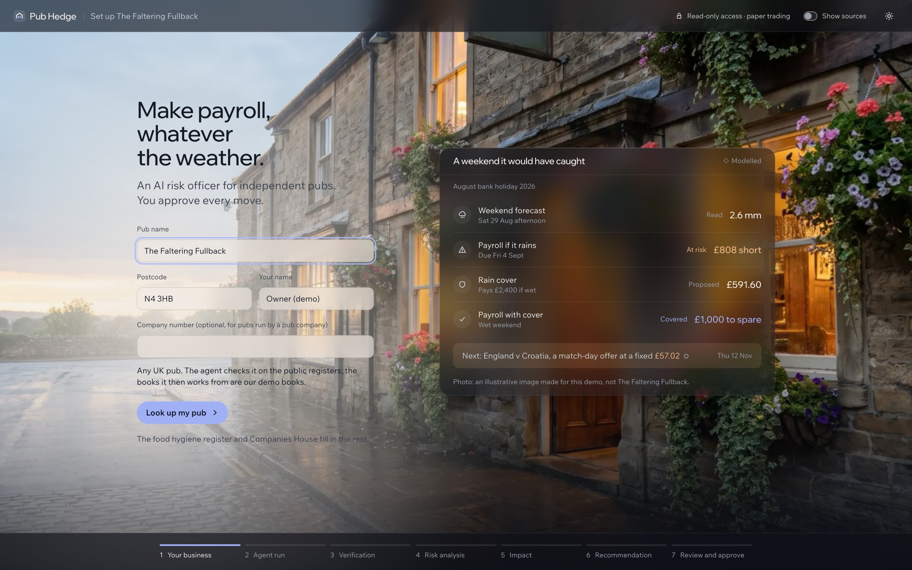
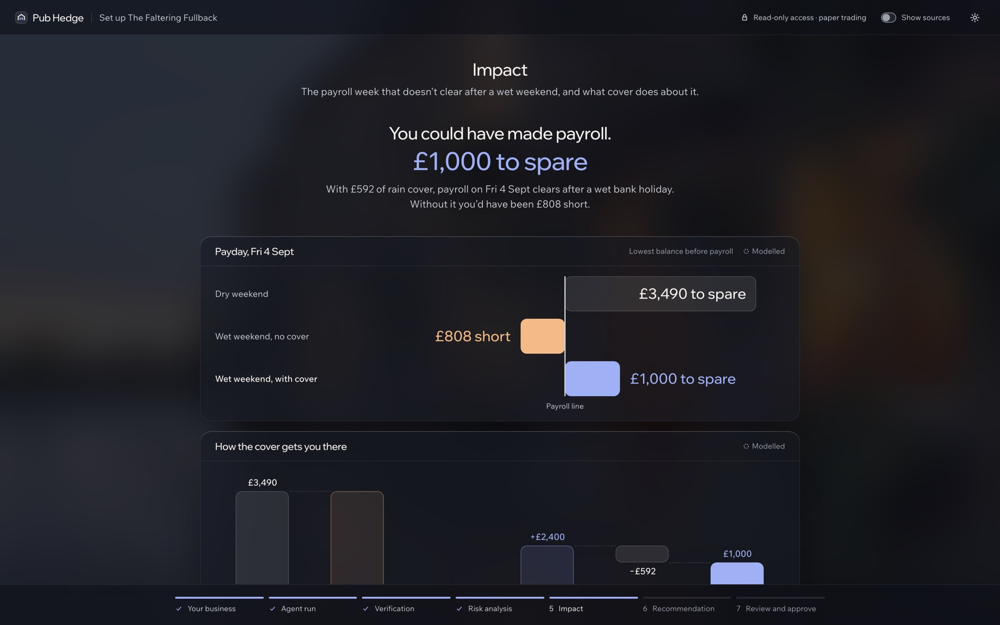
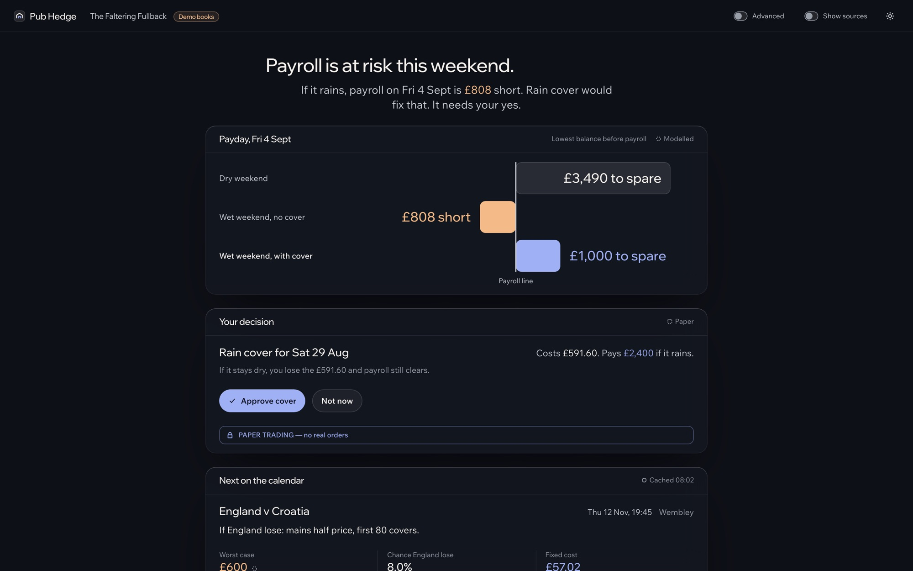
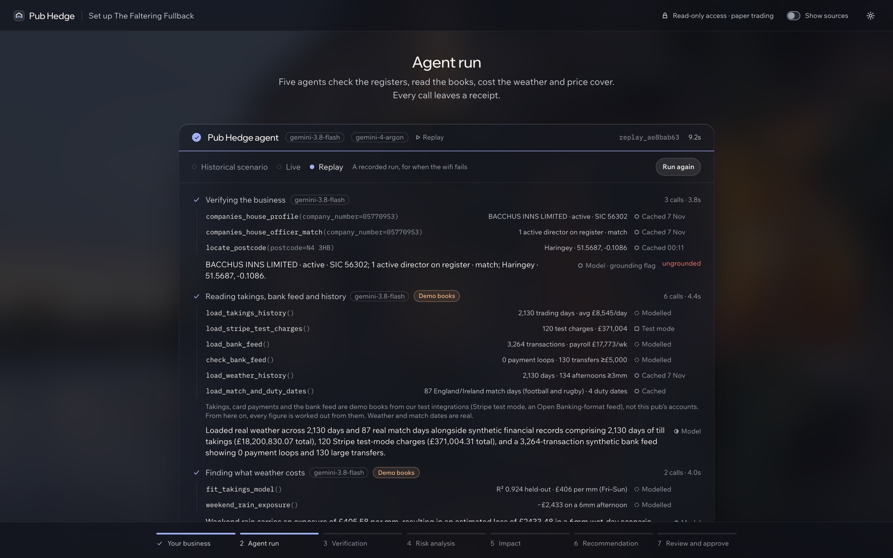
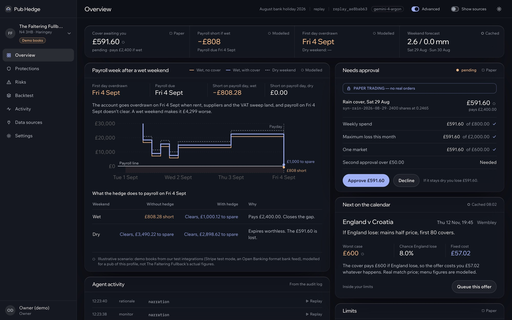
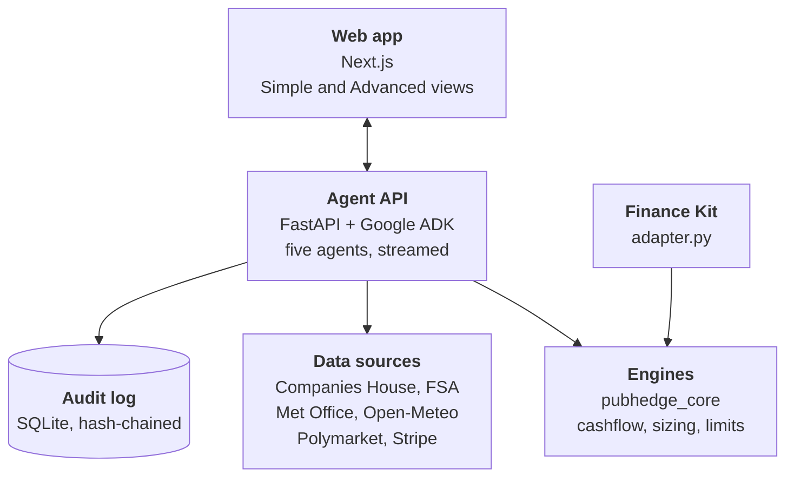

<div align="center">

# Pub Hedge

### Make payroll, whatever the weather.

**An AI agent that warns an independent UK pub, days ahead, when a wet weekend will leave Friday's payroll
short, and offers to fix it with a small, capped bet that pays out if it rains. The owner approves every bet;
in this demo every trade is simulated.**


[**Live demo**](#live-demo) · [The idea](#the-idea-in-30-seconds) · [How the agent works](#how-the-agent-works) · [What's real](#what-is-real-and-what-is-made-up) · [Results](#results) · [Run it](#run-it-locally) · [Glossary](#glossary)



</div>

## Live demo

<div align="center">

### [pubhedge.vercel.app](https://pubhedge.vercel.app)

| Username | Password |
|---|---|
| `pubhedge` | `finance` |

</div>

Click **Use the demo pub** → **Look up my pub** → **Run the agent**. **Historical scenario** runs the agents live
(about 40 seconds); **Replay** plays back a recorded run in seconds. Press **S** at any point to see where every
number came from.

> [!IMPORTANT]
> The demo pub, **The Faltering Fullback** (N4 3HB), is real, but we use only its public records. **All of its
> money figures are made up: modelled for a pub of this profile, not the pub's actual figures.** The photo is an
> illustrative image made for this demo.

## The idea in 30 seconds

Rain empties a pub's beer garden. For our demo pub, a wet Saturday afternoon costs about **£2,433** in takings.
On the August 2026 bank holiday that would have left **Friday's payroll £808 short**.

Pub Hedge spots that on the Thursday and proposes **cover**: a contract that pays **£1 per share if at least 3 mm
of rain falls on Saturday afternoon**. Contracts like this trade on *prediction markets*, where a share's price is
roughly the chance of it happening. The forecast put rain at about 20%; with the market's margin and fees a share
cost 24.65p, so 2,400 shares cost £591.60.

| | No cover | With £591.60 of cover (2,400 shares) |
|---|---|---|
| **It rains** (it did: 6.1 mm) | Payroll **£808 short** | Cover pays £2,400 → payroll clears with **£1,000 to spare** |
| **It stays dry** | Payroll clears with £3,490 to spare | The £591.60 is lost → payroll still clears with **£2,899 to spare** |

So the pub pays a known, small amount to make sure payroll clears either way. The agent finds the risk, sizes
the cover inside the owner's limits, and explains it; **the owner says yes or no.**

<table>
  <tr>
    <td width="50%"><br><sub><b>The warning.</b> £808 short without cover; £1,000 to spare with it.</sub></td>
    <td width="50%"><br><sub><b>The decision.</b> The owner's view: one sentence, the payday picture, approve or not.</sub></td>
  </tr>
  <tr>
    <td width="50%"><br><sub><b>The agents at work.</b> Every tool call streams live, each with its source.</sub></td>
    <td width="50%"><br><sub><b>The full working.</b> Cash path, limit checks, audit log and a match-day offer.</sub></td>
  </tr>
</table>

## How the agent works

One click starts a run of **five Gemini agents** (Google ADK). Each agent has its own tools, decides which to
call and in what order, and explains what it found in plain English. Everything streams to the screen as it
happens.

| # | Agent | What it does | Tools it can call |
|---|---|---|---|
| 1 | **Verifier** | Confirms the pub is real and finds who runs it | Google Maps (via Gemini) to find the postcode, the food hygiene register, Companies House (company, directors, register checks), postcodes.io |
| 2 | **Ingest** | Loads the pub's books and history | Takings, card payments (Stripe test mode), bank feed with a loop check, five years of local weather, match days and duty dates |
| 3 | **Risk** | Works out what rain costs this pub | Fits takings against rain, heat, match days and duty (a regression with confidence intervals) |
| 4 | **Pricer** | Prices protection for the weekend | Met Office forecast, real Polymarket weather markets, the rain contract's price, payroll projected dry and wet, the cover sized to the limits |
| 5 | **Monitor** | Checks the owner's limits and queues the decision | Limit check, approval queue, re-check schedule, and a match-day offer for the next big game |

Then a final **rationale** explains the recommendation. Two models race to write it: **Gemini 4 Argon** (slower,
better reasoning) and **Gemini 3.8 Flash** (fast). Both start as soon as the cover is sized; if Argon isn't back
when the run finishes, Flash's answer is used and labelled *"Flash used, Argon not back yet"*, so the demo never
waits.

**Who decides what:**

- **The agents choose and explain.** They pick which tools to call and write every sentence you read.
- **The code computes.** Every number comes from a tool: the regression, the cashflow projection, the exact
  sizing, the limit checks. A required tool the model skipped is run anyway, and a **grounding check** deletes
  any number in the agents' text that no tool produced. The model cannot change a figure or the decision.
- **The owner approves.** Nothing is placed without a yes; anything over £50 needs a second yes. Limits are
  enforced in code (£800 a week, £2,000 a month, £600 on any one contract), and lowering one blocks pending
  cover at once.
- **Every step leaves a receipt**: the tool call, its inputs, the raw response and a hash, in an append-only
  audit log. Click any number to open its receipt.

If Gemini is unavailable, the same pipeline still completes and the text is written from the tool outputs by a
fixed template, labelled TEMPLATE.



## What is real and what is made up

| Real (live or cached public data) | Made up (always labelled) |
|---|---|
| The pub's identity: Google Maps (postcode), the FSA food hygiene register, Companies House (company and directors), postcodes.io | The pub's takings, bank feed and fixed costs (a seeded generator) |
| Weather: Met Office forecast, Open-Meteo history and archived forecasts | The rain contract and its price: no London rain market exists, so it is priced from calibrated forecasts |
| Polymarket's real match and temperature markets, read only | Every trade: simulated on our own paper exchange (PAPER); Stripe payments are TEST MODE |
| England and Ireland match days, beer duty dates | The 12 pubs in the backtest |

Every number in the app carries a small label saying which kind it is: **Live**, **Cached** (a real response
saved at a stated time), **Modelled** (made up), **Test mode**, **Paper**, **Replay** or **Template**. Every source
with its licence is in [docs/data-sources.md](docs/data-sources.md).

**Why simulated trades?** Polymarket blocks UK users, so we only read its prices. In production, trades would go
to a UK-licensed betting exchange (Smarkets or Betfair), shown in the app as "not connected in demo".

## Results

> [!NOTE]
> Our own checks, not official judging.

**The honest headline:** over 24 held-out months on 12 made-up pubs with real weather, our policy roughly breaks
even (+£26 a pub-year, 95% CI −£132 to +£222), while buying cover every weekend loses £1,514 a year. At these
small limits it does **not** reduce the number of weeks payroll falls short. The warning is the product; the
cover softens the weather-driven part.

| Check | Result |
|---|---|
| Hackathon Finance Kit, cashflow and transaction tasks ([docs/challenge/](docs/challenge/README.md)) | 40/40 exact checks, payment-loop detection 100% (F1), 0 errors |
| Finance Kit trading task: our moving-average trend rule against buy-and-hold | No edge: 23 wins, 37 losses (p = 0.09) |
| Backtest ([docs/backtest-results.md](docs/backtest-results.md)) | As above |

## Run it locally

Needs [`uv`](https://docs.astral.sh/uv/) (Python 3.12 is pinned), Node 20+ and npm.

```bash
cp .env.example .env.local          # add your own keys; never commit this file
scripts/dev.sh                      # API on :8000, app on http://localhost:3000
PUBHEDGE_OFFLINE=1 scripts/dev.sh   # no keys needed: saved data, template text, no live calls
```

Only Gemini, Companies House, the Met Office and Stripe (test mode) need keys; where to get each is in
[`.env.example`](.env.example). `scripts/check.sh` runs every check (lint, tests, build, a replayed run and an
end-to-end browser test) without spending any API quota.

In the app, **Historical scenario** replays the August 2026 bank holiday with the forecast that was available at
the time (2.6 mm forecast, 6.1 mm fell). **Live** uses this coming weekend's Met Office forecast. **Replay**
streams a recorded run, for when the venue wifi fails.

**Judges: run our Finance Kit adapter.** It is standard library only, Python 3.9+, and calls the same engines as
the app (each run needs a new `--output`):

```bash
python3 agentverse/finance/bench.py challenge --pack mixed --cases 60 --project . --output /tmp/ph-challenge-$(date +%s) --adapter python3 adapter.py
```

## Glossary

| Term | Meaning here |
|---|---|
| **Cover** | A contract that pays £1 per share if it rains enough; the pub's protection. (Traders would call it a hedge.) |
| **Prediction market** | A market where people trade on whether something will happen; a share's price is roughly its probability |
| **Share** | One £1 contract. 2,400 shares pay £2,400 if it rains |
| **Paper / simulated trade** | Recorded as if placed, on our own exchange; no real money moves |
| **Headroom / to spare** | How much is left in the account after Friday's payroll; negative means short |
| **Receipt** | The record behind a number: the tool call, its inputs, the raw response and a hash |
| **Grounding check** | Deletes any number in the agents' text that no tool produced |
| **Finance Kit / adapter** | The hackathon's scoring harness, and `adapter.py`, which lets it call our engines |
| **Flash / Argon** | Two Gemini models: Flash runs the agents, Argon writes the final explanation when it is back in time |

## Documentation

| Doc | What's in it |
|---|---|
| [docs/demo-script.md](docs/demo-script.md) | The three-minute demo, beat by beat |
| [docs/data-sources.md](docs/data-sources.md) | Every data source, its licence, and every modelling assumption |
| [docs/backtest-results.md](docs/backtest-results.md) | The backtest method and its full results |
| [docs/challenge/](docs/challenge/README.md) | Finance Kit challenge runs |
| [docs/DEPLOY.md](docs/DEPLOY.md) | How the live demo is deployed (Vercel plus Cloud Run) and where the keys live |
| [docs/deck-updates.md](docs/deck-updates.md) | Pitch-deck claims checked against the build |
