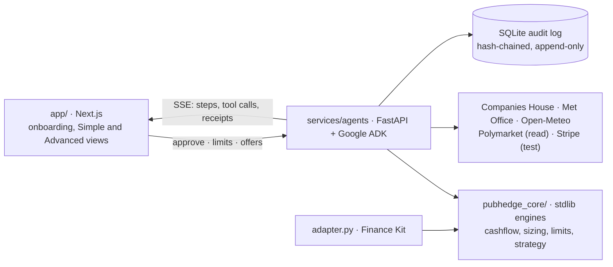

<div align="center">

# Pub Hedge

**An AI risk officer for independent UK pubs.**
It reads the till and the bank feed, works out what a wet weekend costs, warns you before Friday's payroll
won't clear, and proposes small, capped weather cover. You approve every move. Execution is paper only.


[Run it](#run-it) · [For judges](#for-judges-run-the-adapter) · [What's real](#what-is-real-and-what-is-synthetic) · [Results](#results) · [Architecture](#architecture) · [Deploy](docs/DEPLOY.md)


</div>

> [!IMPORTANT]
> The demo pub is **The Faltering Fullback** (Bacchus Inns Ltd, 05770953, N4 3HB), used for public identity
> data only. **All of its financials are synthetic: modelled for a pub of this profile, not The Faltering
> Fullback's actual figures.** The photo is an illustrative image made for this demo.

## What it does

| | |
|---|---|
| **Warns before payroll fails** | Projects the cash balance to Friday's payroll with the same cashflow engine the Finance Kit scores, both for a dry weekend and a wet one. |
| **Prices the weather** | Fits what each millimetre of weekend-afternoon rain costs the pub, reads the forecast, and prices cover that pays out if it rains. |
| **Proposes, never places** | Sizes cover exactly within your limits, explains it in plain words, and waits for your yes. Over £50 needs a second confirmation. |
| **Shows its working** | Every figure has a receipt: the tool call, its inputs, the raw source and a hash in an append-only audit log. Press **S** to see where every number came from. |

<table>
  <tr>
    <td width="50%"><br><sub><b>Impact.</b> A wet bank holiday leaves payroll £808 short; £592 of cover leaves £1,000 to spare.</sub></td>
    <td width="50%"><br><sub><b>Simple view.</b> One sentence, the payday picture and one decision, for the owner.</sub></td>
  </tr>
  <tr>
    <td width="50%"><br><sub><b>Agent run.</b> Five ADK agents stream their tool calls; each line carries its source.</sub></td>
    <td width="50%"><br><sub><b>Advanced view.</b> The full working: cash path, limit checks, audit log and a match-day offer.</sub></td>
  </tr>
</table>

A three-minute click path is in [docs/demo-script.md](docs/demo-script.md), and a recorded walkthrough is in
[docs/demo-walkthrough.webm](docs/demo-walkthrough.webm).

## Run it

Needs [`uv`](https://docs.astral.sh/uv/) (Python 3.12 is pinned for the service), Node 20+ and npm.

```bash
cp .env.example .env.local          # add your own keys; never commit this file
scripts/dev.sh                      # API on :8000, app on http://localhost:3000
PUBHEDGE_OFFLINE=1 scripts/dev.sh   # no keys needed: cached data, template narration, no live calls
```

Where each key comes from is written next to it in [`.env.example`](.env.example). Every service except
Gemini, Companies House, the Met Office and Stripe (test mode) needs no key.

| Script | Purpose |
|---|---|
| `scripts/dev.sh` | Runs the app. With `PUBHEDGE_OFFLINE=1` it makes no live API or model calls |
| `scripts/check.sh` | The gate: lint, unit tests, adapter practice run (Python 3.9 and current), tsc, lint, build, health checks, a REPLAY run over SSE, and Playwright end to end. It spends no API quota or model tokens. Needs ports 3000 and 8000 free |
| `scripts/smoke.sh` | `check.sh`, plus one live ping per API and one live agent run |
| `scripts/demo-reset.sh` | Resets proposals, paper fills and limits for the demo. The audit log is kept |
| `scripts/deploy.sh` | Cloud Run plus Vercel, password protected. See [docs/DEPLOY.md](docs/DEPLOY.md) |

In the app, **Historical scenario** replays a real wet weekend: the August bank holiday, 29–30 Aug 2026, with
6.1 mm of rain on the Saturday afternoon (2.6 mm had been forecast), using the forecast available at the time.
**Live** uses this coming weekend's Met Office forecast. **Replay** streams a recorded live run, for when the
venue wifi fails.

## For judges: run the adapter

The Finance Kit adapter is standard library only and runs on Python 3.9+ from any working directory:

```bash
python3 agentverse/finance/bench.py challenge --pack mixed --cases 60 --project . --output /tmp/ph-challenge-$(date +%s) --adapter python3 adapter.py
```

The kit refuses an existing output folder, so each run needs a new `--output`. `adapter.py` calls
`pubhedge_core/`, the same engines the app uses.

## Results

> [!NOTE]
> These are our own checks, not official judging. The full write-ups are linked.

| Check | Result |
|---|---|
| Finance Kit self-serve challenge, mixed pack ([docs/challenge/](docs/challenge/README.md)) | 40/40 exact checks, transactions F1 100%, 0 errors |
| Market-timing rule on real-market windows | No edge over buy-and-hold: 23 wins, 37 losses (p = 0.09) |
| Backtest, 24 held-out months, 12 synthetic pubs, real weather ([docs/backtest-results.md](docs/backtest-results.md)) | Our policy about break-even (+£26 a pub-year, 95% CI −£132 to +£222), against −£1,514 for hedging every weekend. It does not cut payroll-shortfall weeks at these caps, and we say so |

## What is real and what is synthetic

| Real | Synthetic (always labelled) |
|---|---|
| Companies House profile and officer match, postcode lookup | Daily takings, bank feed and fixed costs (seeded generator, `data/synthetic/manifest.json`) |
| Met Office forecast (live), Open-Meteo weather and archived forecasts | The rain contract and its price: no London rain market exists on Polymarket |
| Polymarket match and temperature markets and fees (read-only) | Paper fills (PAPER). Stripe charges are TEST MODE |
| England and Ireland match days; beer duty change dates | The 12-pub backtest panel |

Every source with its licence: [docs/data-sources.md](docs/data-sources.md).

## Architecture



Five agents run in turn: **verifier → ingest → risk → pricer → monitor** (Gemini 3.8 Flash), then one hedge
rationale (Gemini 4 Argon).

- **The model never computes numbers.** Tools do the maths: OLS regression with confidence intervals, the
  exact sizing solver, the limit guard, the cashflow engine and the paper exchange. A grounding check removes any
  number in the narration that doesn't appear in that run's tool outputs.
- **Limits are enforced in code** (`pubhedge_core/limits.py`): £800 a week, £2,000 a month, £600 a market.
  Anything over £50 needs a second confirmation. Lowering a cap re-checks pending cover at once and logs the
  block.
- **If Gemini fails,** the deterministic pipeline still completes and the narration is labelled TEMPLATE.
- **Paper trading only.** Polymarket is read-only (UK users can't trade there). Real execution would go to a
  UK-licensed venue (Smarkets, Betfair), shown as "not connected in demo".

## Documentation

| Doc | What's in it |
|---|---|
| [docs/demo-script.md](docs/demo-script.md) | The three-minute demo, beat by beat |
| [docs/DEPLOY.md](docs/DEPLOY.md) | Vercel plus Cloud Run, the site password and where the keys live |
| [docs/data-sources.md](docs/data-sources.md) | Every data source, its licence, and every modelling assumption |
| [docs/backtest-results.md](docs/backtest-results.md) | The backtest method and its full results |
| [docs/challenge/](docs/challenge/README.md) | Finance Kit challenge runs |
| [docs/deck-updates.md](docs/deck-updates.md) | Pitch-deck claims checked against the build |
